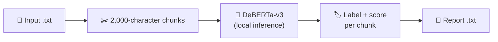

<div align="center">

# 🔍 AI Text Detector

### Check documents for AI-generated text — 100% locally, nothing leaves your machine


| 🔒 Private | 🧩 Granular | 🌐 Two interfaces | 🐳 Portable |
|:---:|:---:|:---:|:---:|
| Runs on your machine | Label + score for every ~2,000 characters | Web app and terminal script | Slim, CPU-only Docker image |

</div>


---

## 💡 Overview

A side project built in my spare time to answer a **real user need**: checking academic drafts for AI-generated text *without* uploading confidential, unpublished work to an online detector.

The document is split into chunks, each chunk is classified by a fine-tuned DeBERTa-v3 model, and a `.txt` report is produced. Everything runs locally; the only network access is a one-time download of the model weights from the Hugging Face Hub.

> [!NOTE]
> AI-text detection is a hard problem and this model has documented limits, especially on academic writing. See [Model and Limitations](#-model-and-limitations).

## ✨ Features

- 🔒 **Local inference:** no document is sent to any external service.
- 🧩 **Chunk-level report:** shows *where* suspicious passages appear, not just a single verdict.
- 🌐 **Web app (Gradio):** upload, progress bar, report preview and one-click download.
- ⌨️ **Command-line script:** interactive, for terminal workflows.
- 🛡️ **Input validation:** clear errors for missing or empty files.
- 🐳 **Docker support:** lean CPU-only image, non-root user and a persistent model cache.

## 🛠️ Technical Highlights

| | Area | What this project shows |
|:---:|---|---|
| 🧠 | **NLP / Transformers** | Fine-tuned DeBERTa-v3 sequence classifier via 🤗 Transformers; long documents handled through chunking |
| 🔬 | **Critical evaluation** | Documents the generalization gap between the model's training data and academic prose |
| 🔒 | **Privacy by design** | Local, offline-capable pipeline with no external uploads |
| 📦 | **Packaging** | Slim, CPU-only, non-root Docker image; named volume so weights download only once |
| ⚖️ | **Compliance** | Third-party license review and attributions |
| 🧭 | **Usability** | Browser UI for non-technical users plus a CLI |

**Stack:** Python · 🤗 Transformers · PyTorch · SentencePiece · Gradio · Docker Compose

## 📋 Requirements

| Element | Version | Description |
|---|---|---|
| 🐍 **Python** | 3.12+ | Runtime (the CLI script uses 3.12 syntax) |
| 🤗 **transformers** | ≥ 4.40.0 | Model loading and inference pipeline |
| 🔥 **torch** | ≥ 2.0.0 | Deep-learning backend; CPU is enough |
| 🔤 **sentencepiece** | any | Tokenizer dependency |
| 📦 **protobuf** | any | Tokenizer dependency |
| 🎛️ **gradio** | ≥ 5.0 | Web interface |
| 🧮 **RAM** | 8 GB recommended | Model inference on CPU |
| 💾 **Disk space** | 5 GB free | Dependencies and model weights |
| 🌐 **Network** | First run only | One-time model download from the Hugging Face Hub |
| 🐳 **Docker + Compose** | Compose v2 *(optional)* | Only for the container option |

Python packages are listed in `requirements.txt`.

## 🚀 Get Started

### 💻 Run locally

```bash
# 1. Clone the repository
git clone https://github.com/<your-username>/<repository-name>.git
cd <repository-name>

# 2. Create and activate a virtual environment
python -m venv .venv
source .venv/bin/activate          # Windows: .venv\Scripts\activate

# 3. Install the dependencies
pip install -r requirements.txt

# 4. Start the web app
python app.py
```

The app runs on `localhost`, port `7860` by default, and is only reachable from your own computer. If that port is busy, Gradio picks the next free one and prints it in the terminal. Prefer the terminal? See [Command line](#%EF%B8%8F-command-line).

> [!TIP]
> The first start is slower: the model is downloaded once and cached on disk. Later starts reuse it.

<details>
<summary>Optional: smaller PyTorch install (Linux)</summary>

Run `pip install torch --index-url https://download.pytorch.org/whl/cpu` before step 3 to get the CPU-only build, which is much smaller than the default one.

</details>

### 🐳 Run with Docker

```bash
git clone https://github.com/<your-username>/<repository-name>.git
cd <repository-name>

docker compose up --build
```

Wait until the logs show that Gradio is running (the first start downloads the model). The app is then available on `localhost`, port `7860`.

- The image does **not** contain the model: weights go into a named volume (`hf_cache`) and are reused on every later run.
- Stop with `Ctrl+C` and `docker compose down`. Add `-v` to also delete the cached model.

> [!WARNING]
> With the provided `docker-compose.yml`, port `7860` is published on all network interfaces of the host, so other devices on the same network can also reach the app, and it has no authentication. Use it on trusted networks only. To restrict it to your own computer, change the port mapping to `127.0.0.1:7860:7860`.

## 🎮 Usage

### 🌐 Web interface

1. Upload a `.txt` file.
2. Follow the progress bar while the chunks are analysed.
3. Read the preview and download the report. It is named after your file (`my_essay.txt` → `my_essay_report.txt`).

### ⌨️ Command line

```bash
python AI_detector_DeBERTa-v3.py
```

```text
Introduce the name of your file: my_essay
Introduce the name of your report file: my_essay_report
Analysing 12 chunks using DeBERTa-v3...
...
Analysis complete. Report saved to ./my_essay_report.txt
Do you want to continue? [Y/N]
```

- Enter names **without** the `.txt` extension.
- Files are read from and written to the folder in the `DATA_DIR` environment variable (current folder by default; it must already exist). Example on Linux/macOS: `DATA_DIR=data python AI_detector_DeBERTa-v3.py`.
- An existing report with the same name is overwritten.

## 📄 Example Output

```text
AI DETECTION REPORT
Model used: vraj33/ai-text-detector-deberta
Total Chunks: 2

--- CHUNK 1 ---
TEXT: <first 100 characters of the chunk>...
LABEL:
Human

SCORE:
0.9987

**************************************************
--- CHUNK 2 ---
...
```

*Values are illustrative.*

| Field | Meaning |
|---|---|
| 📝 **TEXT** | First 100 characters of the chunk, to locate it in the source |
| 🏷️ **LABEL** | `AI` (machine-generated) or `Human` (human-written) |
| 📊 **SCORE** | Model confidence in the predicted label, from `0.0` to `1.0` |

> [!IMPORTANT]
> The score is the model's confidence in its own prediction, **not** the probability that the text was written by an AI.

## ⚙️ How It Works



The model is loaded once at startup. Each chunk is classified separately, `LABEL_0` is mapped to `AI` and `LABEL_1` to `Human`, and the results are assembled into the report. In the web app, chunks longer than the model's token limit are truncated instead of raising an error.

## 🧠 Model and Limitations

**Model:** [`vraj33/ai-text-detector-deberta`](https://huggingface.co/vraj33/ai-text-detector-deberta), fine-tuned from [`microsoft/deberta-v3-base`](https://huggingface.co/microsoft/deberta-v3-base) (about 0.2 B parameters). It is downloaded at runtime; **no weights are stored in this repository or in the Docker image**.

| | According to the model card |
|:---:|---|
| 📚 | **Training data:** human-written Wikipedia articles vs. Wikipedia-style articles generated with GPT-Neo (1.3B) |
| 🎯 | **Reported accuracy:** 99.4 % on in-distribution test data (from the model's author; **not** reproduced here) |
| ⚠️ | **Stated limitation:** a *generalization gap*: detectors trained on older generators cannot reliably detect modern models |

> [!WARNING]
> **Academic prose is the hardest case.** Scholarly writing is formal, objective and highly predictable, the same traits detectors associate with machine text. In testing, the detector handles simple human text well but tends to classify academic writing as human. A "Human" verdict is **not** proof that a text was not AI-assisted.

Other known limits:

- ✂️ **Naive chunking:** fixed-size cuts without overlap can split words or sentences, and labels may vary between chunks.
- 🔤 **Token limit:** the web app truncates over-long chunks, so the excess is not analysed.
- 🏷️ **Assumed labels:** `LABEL_0` = AI and `LABEL_1` = Human is hard-coded; any other label is reported as `Unrecognised`.

Best understood as a **local, privacy-preserving screening pipeline** and baseline, not an authoritative judge.

## 🔒 Privacy

- 🏠 Everything runs on your machine; documents are never uploaded anywhere.
- 📡 The only outbound connection is the one-time model download. Afterwards the app can run offline (for example with `HF_HUB_OFFLINE=1`).
- 📊 Gradio sends anonymous usage analytics by default; disable them with `GRADIO_ANALYTICS_ENABLED=False`.
- 🗑️ **Temporary files:** the web app leaves temporary copies of uploads and reports, which are not deleted automatically. With Docker they stay inside the container and disappear with `docker compose down`.
- 💾 **CLI reports** are saved in the `DATA_DIR` folder. Keep documents and reports in a folder that is never committed to version control.
- 📝 **Reports are as sensitive as the source:** each one contains a 100-character preview of every chunk.
- 🌐 **Network exposure:** run locally (`python app.py`), the web app listens on `localhost` only. With Docker, the provided `docker-compose.yml` publishes port `7860` on all host network interfaces, so other devices on your network can reach it. The app has no authentication, so use Docker on trusted networks or publish the port as `127.0.0.1:7860:7860` to keep it private.

## 🗂️ Project Structure

```text
.
├── app.py                      # Gradio web app
├── AI_detector_DeBERTa-v3.py   # Interactive command-line version
├── requirements.txt            # Python dependencies
├── Human.txt                   # Sample human-written text for quick testing
├── Dockerfile                  # python:3.12-slim, CPU-only PyTorch, non-root user
├── docker-compose.yml          # Service, port mapping and model-cache volume
├── LICENSE                     # MIT License
└── README.md                   # This file
```

## 🗺️ Roadmap

- [ ] 📊 Benchmark on academic text (precision, recall, F1 per domain)
- [ ] 🤖 Evaluate or fine-tune on modern LLM outputs and academic corpora
- [ ] 🧱 Shared core module so the web app and the CLI behave identically
- [ ] ⚙️ Configurable model checkpoint and chunk size
- [ ] ✂️ Sentence-aware chunking with overlap and a document-level score
- [ ] 🧹 Automatic cleanup of temporary files
- [ ] 📑 `.docx` and `.pdf` input
- [ ] 📌 Pinned dependency versions for reproducible builds
- [ ] ✅ Automated tests and CI

## ⚠️ Responsible Use

> [!CAUTION]
> AI-text detection is probabilistic and **error-prone, including false positives against human writers**. Do not use this tool's output as the sole basis for academic-integrity, hiring or disciplinary decisions. Treat it as one weak signal and always allow for human review.

## ⚖️ License

Released under the **[MIT License](LICENSE)**. Copyright (c) 2026 `<Your Name>`.

The MIT License covers **only this project's own code and documentation**. Third-party models and libraries are not redistributed here and keep their own terms.

> This software is provided "as is", without warranty of any kind. This is an independent project, not affiliated with or endorsed by Microsoft, Hugging Face, the model's author, Gradio or Docker. All product names and trademarks belong to their respective owners.

### 📜 Third-Party Licenses

| Component | Role | License | Notes |
|---|---|---|---|
| [`vraj33/ai-text-detector-deberta`](https://huggingface.co/vraj33/ai-text-detector-deberta) | Classification model | ⚠️ **None declared on the model card** (checked 13 Oct 2026) | Downloaded at runtime; not included in this repository or in the Docker image. Review the model page for current terms before any redistribution or commercial use. |
| [`microsoft/deberta-v3-base`](https://huggingface.co/microsoft/deberta-v3-base) | Base model | MIT | © Microsoft |
| [🤗 Transformers](https://github.com/huggingface/transformers) | Model loading and inference | Apache 2.0 | |
| [PyTorch](https://github.com/pytorch/pytorch) | Deep-learning backend | BSD-3-Clause | |
| [SentencePiece](https://github.com/google/sentencepiece) | Tokenizer dependency | Apache 2.0 | |
| [Protocol Buffers](https://github.com/protocolbuffers/protobuf) | Tokenizer dependency | BSD-3-Clause | |
| [Gradio](https://github.com/gradio-app/gradio) | Web interface | Apache 2.0 | |

The Docker image is built locally from the official `python:3.12-slim` image (Python Software Foundation License, plus Debian packages under their own licenses); no image is distributed with this repository. According to the model card, the detector was trained on human-written Wikipedia articles (CC BY-SA 4.0) and text generated with GPT-Neo (EleutherAI, MIT); the training data is not part of this repository.

## 🙏 Acknowledgments

Thanks to the authors of **DeBERTa** and **DeBERTa-v3** at Microsoft, to [`vraj33`](https://huggingface.co/vraj33) for publishing the fine-tuned detector, and to the **Hugging Face**, **PyTorch** and **Gradio** communities.

## 📚 Citation

If you build on the underlying architecture, please cite:

- He, P., Gao, J., Chen, W. *DeBERTaV3: Improving DeBERTa using ELECTRA-Style Pre-Training with Gradient-Disentangled Embedding Sharing.* [arXiv:2111.09543](https://arxiv.org/abs/2111.09543)
- He, P., Liu, X., Gao, J., Chen, W. *DeBERTa: Decoding-enhanced BERT with Disentangled Attention.* [arXiv:2006.03654](https://arxiv.org/abs/2006.03654)

## 👤 Author

**`<Your Name>`** — NLP / Machine Learning

[](<your-linkedin-url>)
[](https://github.com/<your-username>)
[](mailto:<your-public-contact-email>)

Feedback, issues and suggestions are welcome. If this tool is useful to you, a ⭐ is appreciated.
